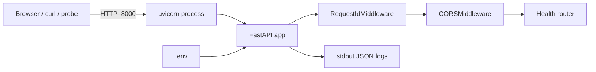
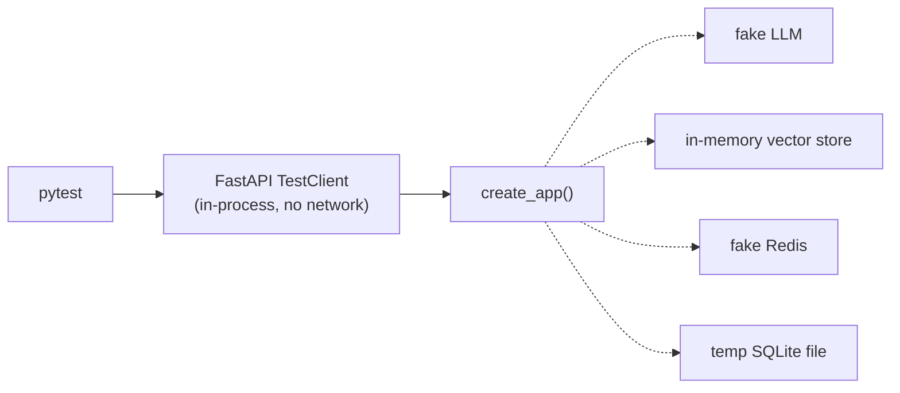
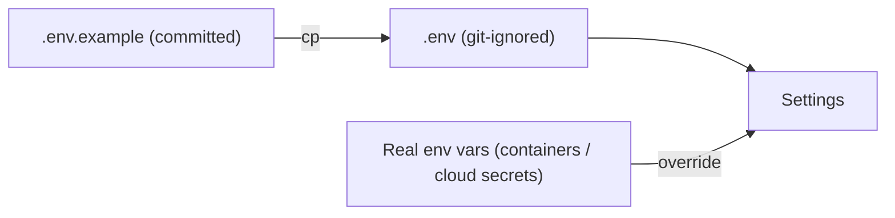
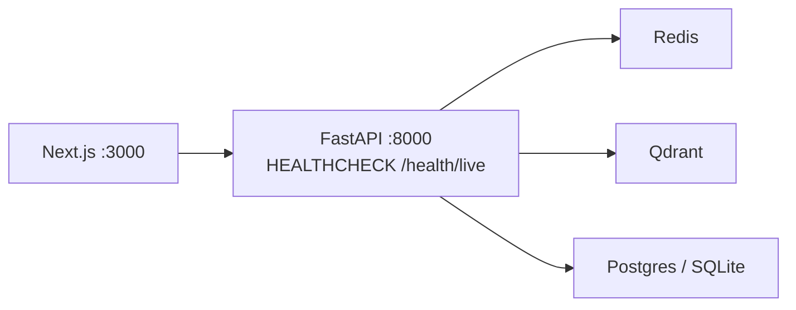

# Phase 1 - Infrastructure Design Evolution

## Honest status
There is **no Docker, Compose or cloud infrastructure yet** (planned for Phase 13; see CLAUDE.md section 15).
In Phase 1 the "infrastructure" is a single local process plus the wiring that later containers will reuse.
This document describes what exists now and the networking contract it is preparing.

## Stage 1 - Local runtime (P1-1, P1-2, P1-4)

Routing table:

| Path | Purpose | I/O | Who calls it |
|---|---|---|---|
| `/health`, `/health/live` | Liveness | none | container/orchestrator probes (future), humans |
| `/health/ready` | Readiness (config probes, 503 when degraded) | none yet | load balancer / smoke test (future) |

Middleware order (request in): RequestId -> CORS -> router. `X-Request-ID` is exposed to browsers via CORS.

## Stage 2 - Offline test wiring (P1-3)

No ports are opened and no external services are used; this is what lets tests run without Docker.

## Stage 3 - Configuration wiring (P1-4)

Environment variables override `.env`, so the same code runs locally, in tests and in containers.

## Preview: where this is heading (not built yet)

Phase 1 fixes the contract: the liveness probe has no I/O, the readiness probe will verify dependencies, and config comes from environment variables.
