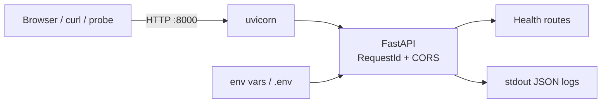
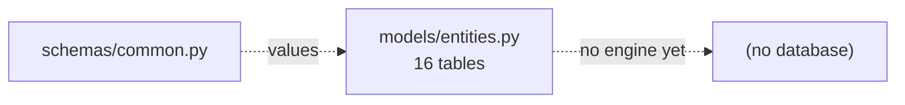
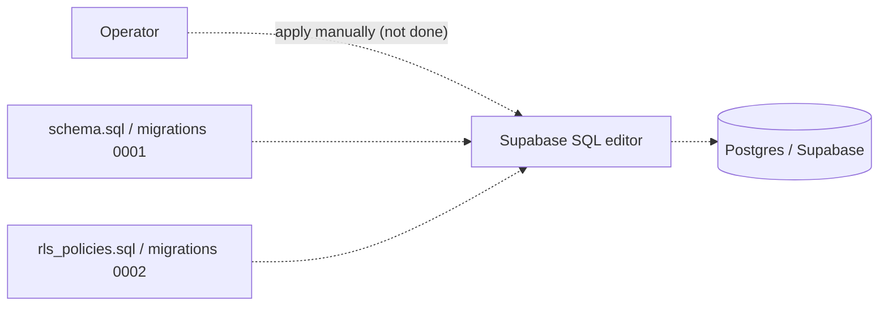
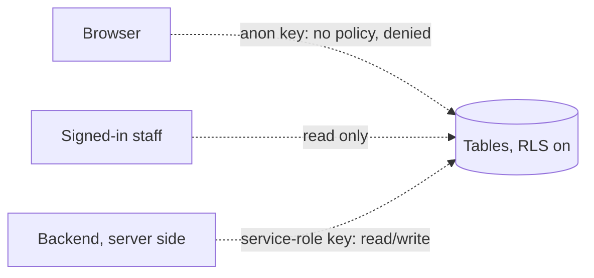
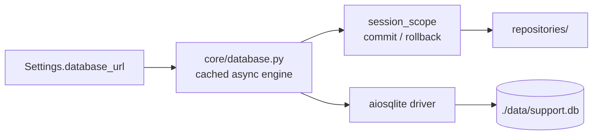
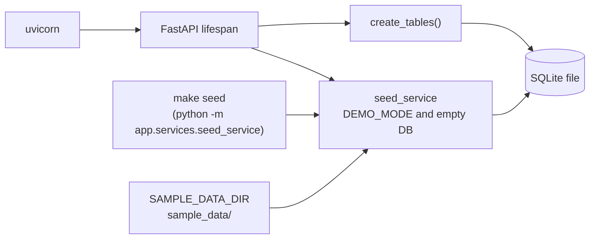
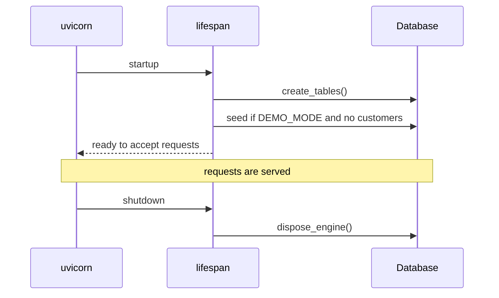
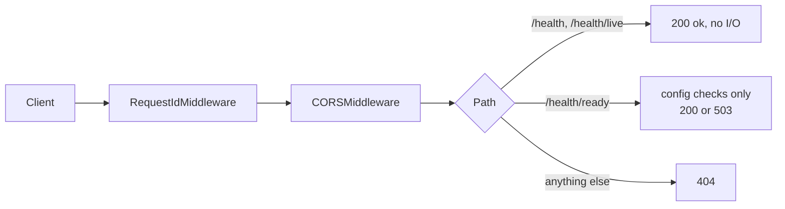
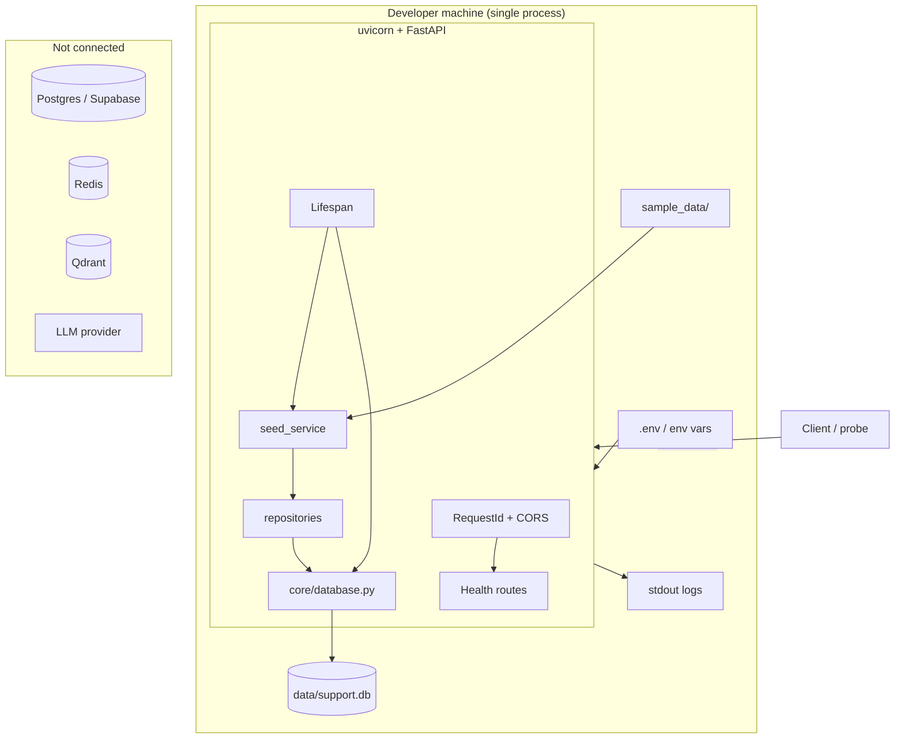

# Phase 2 - Infrastructure Design Evolution (Persistence and demo data)

## Honest status

There is **still no Docker, Compose or cloud infrastructure** (planned for Phase 14 in `TASKS.md`).
No container network exists, so this document describes the **component wiring** that exists now:
one local process, a SQLite file, and files read from disk. Postgres is prepared as SQL only and has
not been connected or run.

HTTP routing is **unchanged from Phase 1**. Phase 2 adds no endpoints.

## Stage 0 - Starting point (end of Phase 1)

## Stage 1 - P2-1 Entities and category enum

No new network connections or processes. A data model is added in code only.

| Component | Role |
|---|---|
| `schemas/common.py` | Single place for categories and other allowed values |
| `models/entities.py` | Table definitions that work on SQLite and Postgres |

New dependencies: `sqlalchemy` and `aiosqlite`.

## Stage 2 - P2-2 Postgres schema, RLS and migrations

SQL files are added. Nothing in the running app reads them.

Apply order for a new database: `schema.sql`, then `rls_policies.sql` (or migrations `0001` then `0002`),
then `seed.sql` (added in P2-4). `rls_policies.sql` uses Supabase's `auth.jwt()` and the `authenticated`
role, so it targets Supabase rather than a plain Postgres server.

### Intended access paths (design, not live)

## Stage 3 - P2-3 Repository layer and database wiring

| Wiring detail | Behaviour |
|---|---|
| Connection string | `DATABASE_URL`, default `sqlite+aiosqlite:///./data/support.db` |
| Engine | One per URL, cached; the parent folder is created for a SQLite file |
| SQLite | `PRAGMA foreign_keys=ON` on every connection |
| Non-SQLite | `pool_pre_ping` enabled to drop dead connections |
| Transactions | Opened by the caller through `session_scope`; repositories only flush |
| Network | None. SQLite is a local file, accessed in the same process |

New dependency: `sqlalchemy[asyncio]` (installs `greenlet`). `asyncpg` is **not** installed.

A relative SQLite path is resolved from the folder the process is started in, so start it from the
repository root.

## Stage 4 - P2-4 Startup bootstrap (end of Phase 2)

### Startup and shutdown order

Operational consequences:
- **Startup now depends on the database.** If it cannot be reached, the app does not start.
- A relative `SAMPLE_DATA_DIR` is resolved from the repository root.
- Containers built later must include `sample_data/` for demo seeding.

## Request routing at the end of Phase 2

No request route touches the database yet. `/health/ready` reports `database: ok` when a URL is
configured; it does not open a connection.

## Final Phase 2 wiring

## Component summary

| Component | State after Phase 2 |
|---|---|
| FastAPI on :8000 | Running locally |
| SQLite | Used for tables and demo data |
| Postgres / Supabase | SQL written, never run; no async driver |
| Redis, Qdrant, LLM | Settings only, no connections |
| Frontend | Not started |
| Docker / Compose / cloud | Not started |
