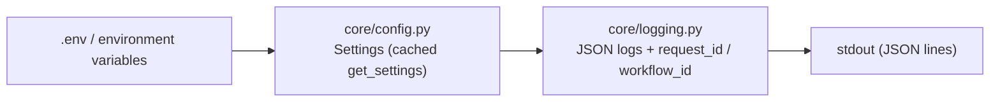
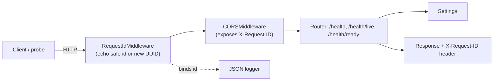
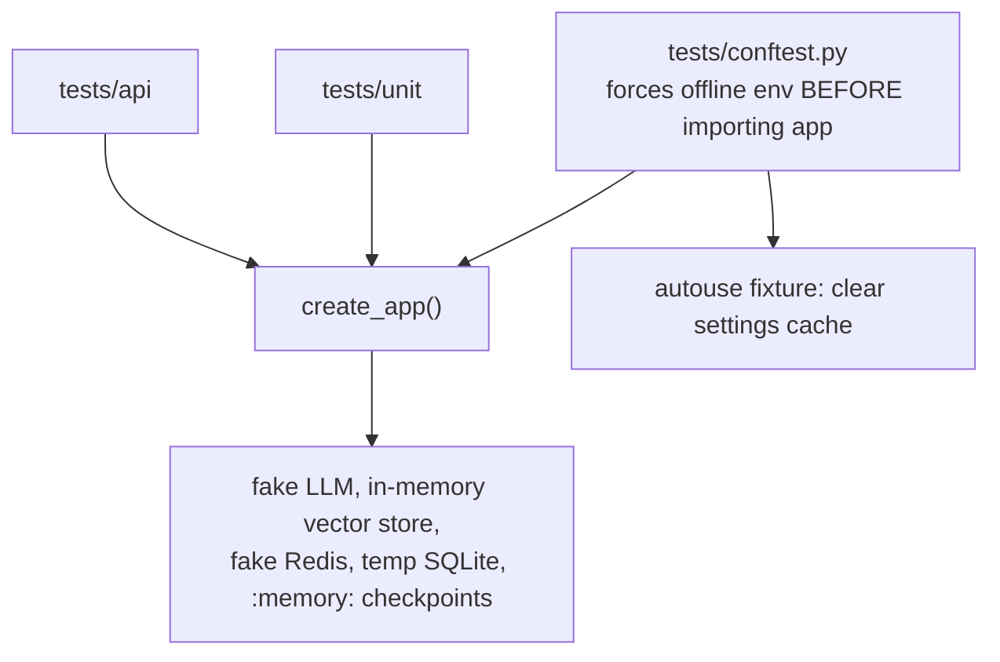
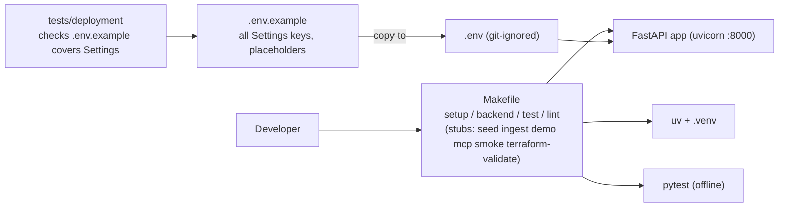
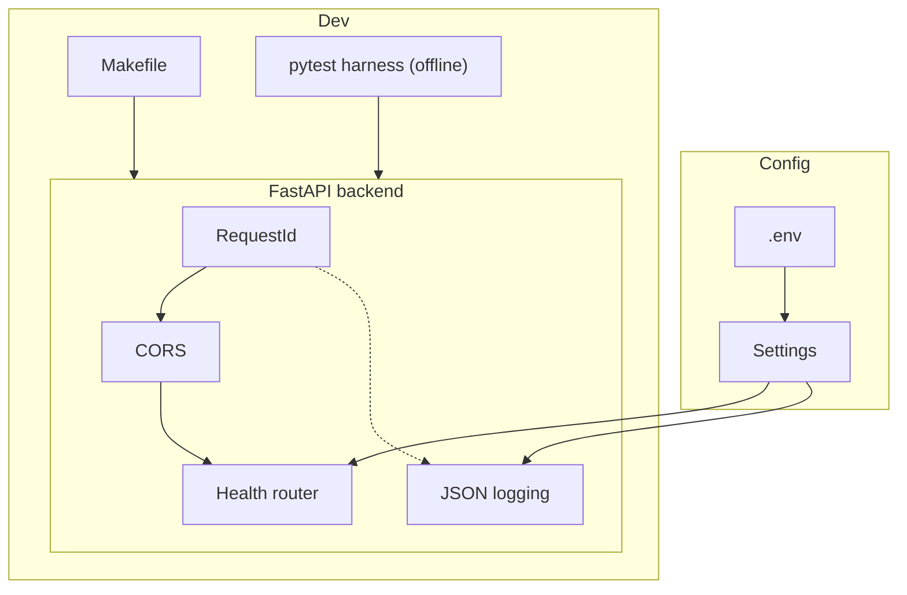

# Phase 1 - System Design Evolution (Runtime skeleton)

Each stage below is one sub-task. The diagram grows as the sub-task lands.

## Stage 0 - Starting point
Only a placeholder `main.py`. No server.

## Stage 1 - P1-1 Settings and JSON logging

Design choices: one cached `Settings` object; secrets stored as `SecretStr` and masked in `model_dump`; URL passwords redacted; log lines are JSON with context ids.

## Stage 2 - P1-2 Health routes and request-id middleware

- `/health` and `/health/live`: no I/O, `{"status":"ok"}`.
- `/health/ready`: configuration probes for database, redis, vector_store, llm. Returns 200 `ready` or 503 `degraded`, never leaking secrets.
- Unhandled errors become a JSON 500 that still carries the request id.

## Stage 3 - P1-3 Offline pytest harness

## Stage 4 - P1-4 Makefile and .env.example (end of Phase 1)

## Final Phase 1 design

Not yet present: database, Redis, vector store, LLM, auth, tickets, agents, frontend (Phases 2+).
