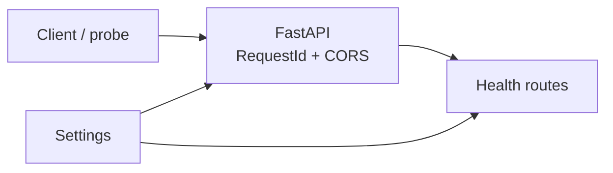
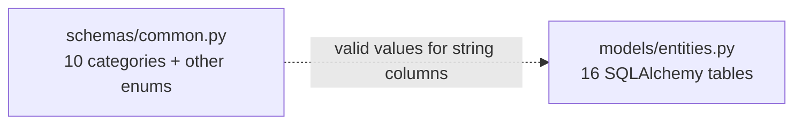
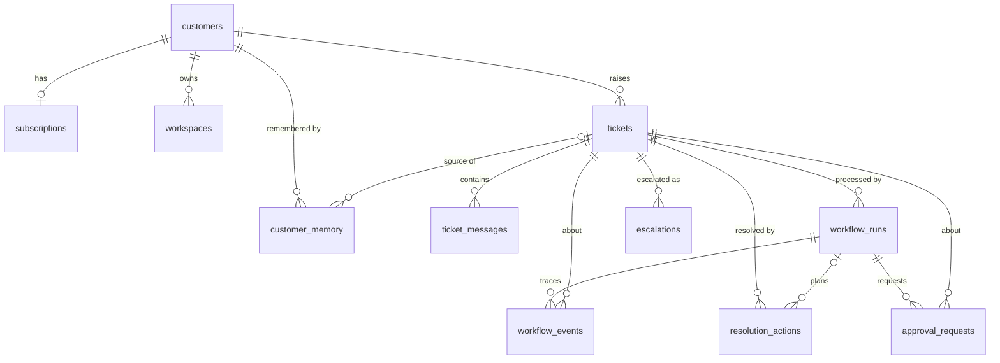
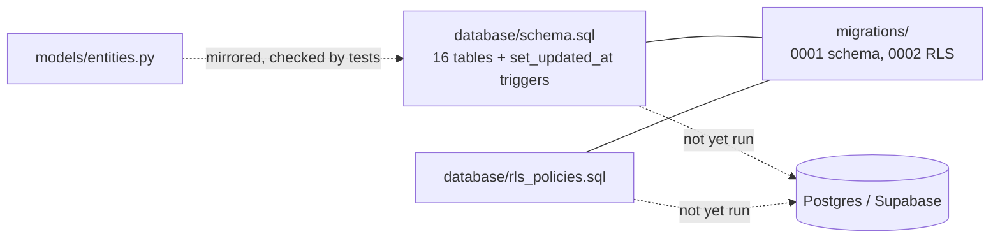
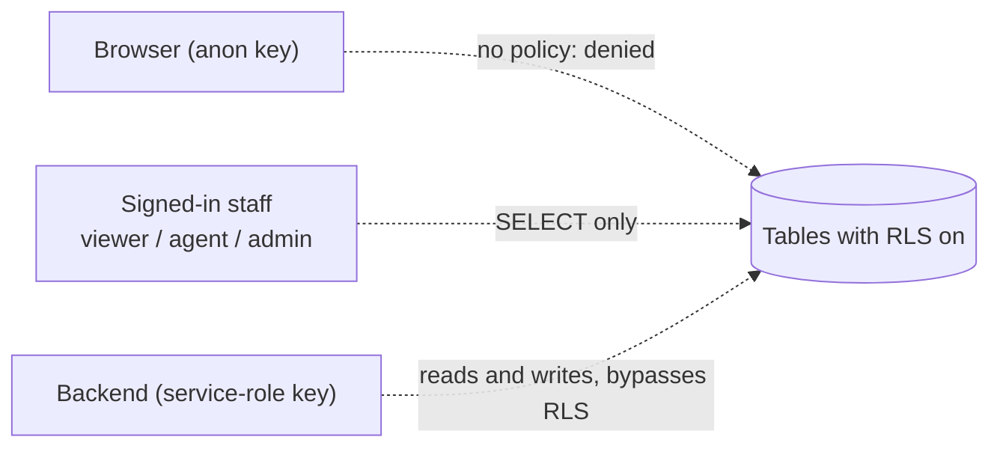
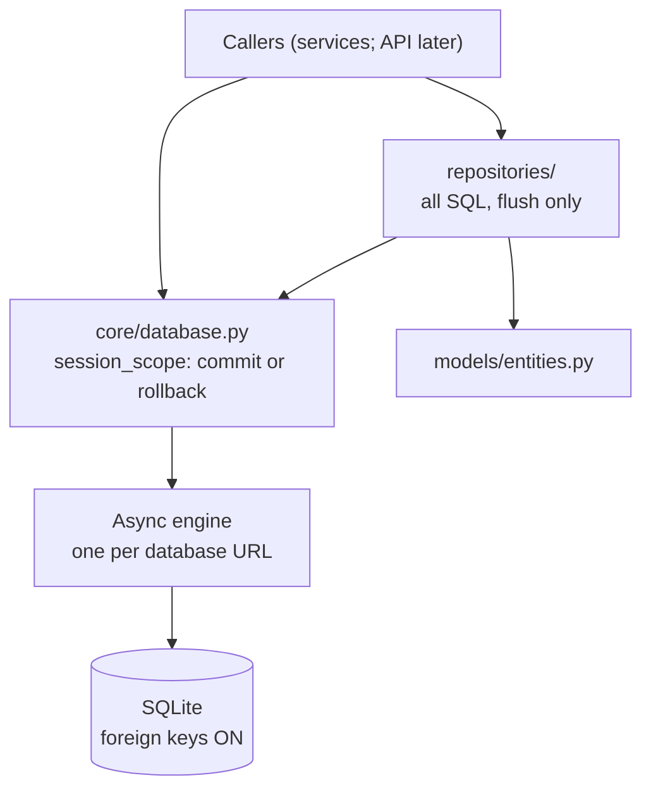
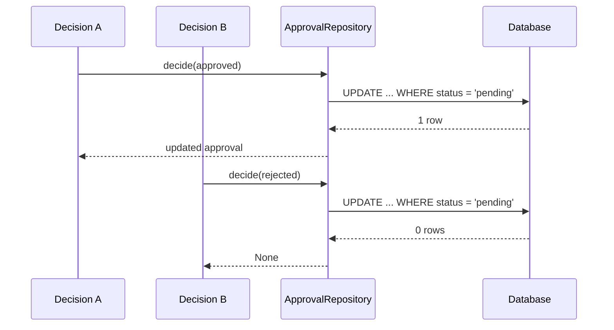
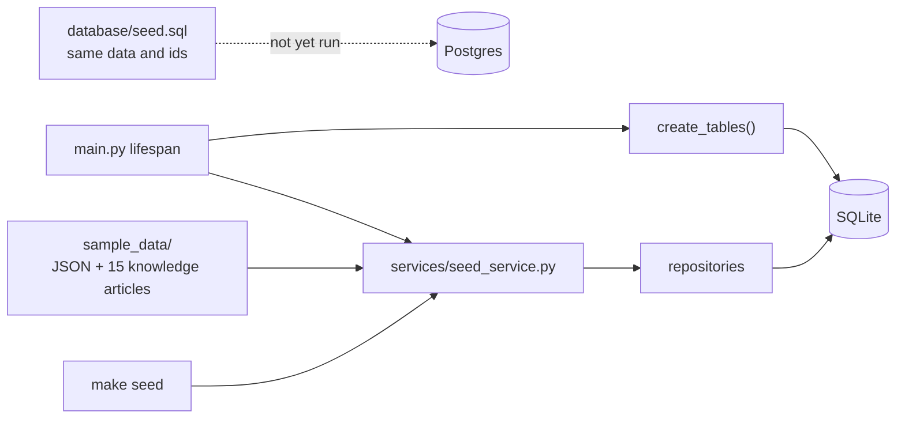
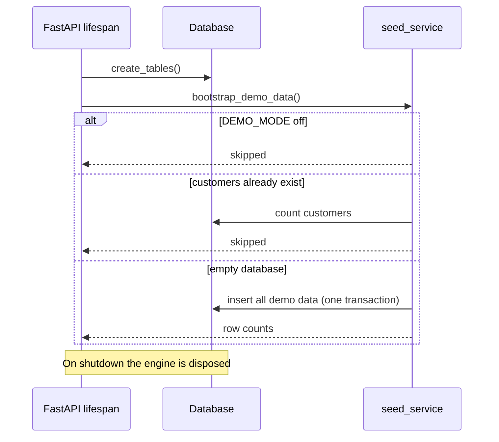
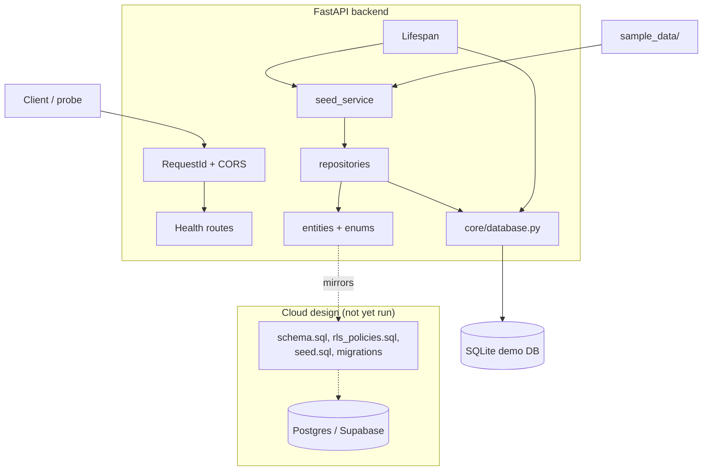

# Phase 2 - System Design Evolution (Persistence and demo data)

Each stage below is one sub-task. The diagram grows as the sub-task lands. Dashed lines mean
"designed or mirrored, but not connected or not run".

## Stage 0 - Starting point (end of Phase 1)

A running API with settings, logging and health routes. Nothing is stored.

## Stage 1 - P2-1 SQLAlchemy entities and category enum

Design choices:
- One model for two databases: `JSON` (not `JSONB`) and `String(36)` UUIDs work on SQLite and Postgres.
- Every table has `id`, `created_at`, `updated_at`.
- Enum-like columns are plain strings. The database does not enforce the allowed values.

### Data model at this stage

Standalone tables (no foreign keys): `profiles`, `products`, `support_articles`, `incidents`, `audit_logs`.

## Stage 2 - P2-2 Postgres schema, RLS and migrations

Access model as designed:

Staff roles come from the `profiles` row matching the token email. A signed-in user can also read their own profile.

## Stage 3 - P2-3 Repository layer

| Repository file | Covers |
|---|---|
| `customers.py` | profiles, customers, subscriptions, workspaces, customer memory (exact duplicates skipped) |
| `tickets.py` | tickets, search, history, ticket numbers, messages, escalations |
| `workflows.py` | runs, events, resolution actions, approvals |
| `knowledge.py` | articles, incidents, products |
| `audit.py` | audit log (update is refused) |

Key rule: the caller owns the transaction. Repositories never commit.

### An approval is decided only once

## Stage 4 - P2-4 Sample data and demo bootstrap (end of Phase 2)

### Startup sequence

Design choices:
- Ids are derived from natural keys (uuid5), so SQLite and `seed.sql` share the same ids.
- All or nothing: a failed load leaves the database empty.
- `previous_resolutions.json` is not a table; a later phase reads it.
- Extra workspace fields (storage used, integrations, SSO, external sharing) live in `workspaces.settings`.

## Final Phase 2 design

## What changed from Phase 1

| Area | End of Phase 1 | End of Phase 2 |
|---|---|---|
| Storage | none | 16 tables on SQLite |
| Startup | nothing | creates tables, seeds demo data |
| Layers | API and core | adds models, repositories, services |
| Cloud database | none | SQL written, not run |

## Not yet present

- `/health/ready` still checks configuration only; it does not open the database.
- No Postgres async driver, so a `postgresql+asyncpg://` URL does not work yet.
- No business API routes, auth, Redis, vector store, LLM, tools, agents or frontend (Phase 3 onward).
